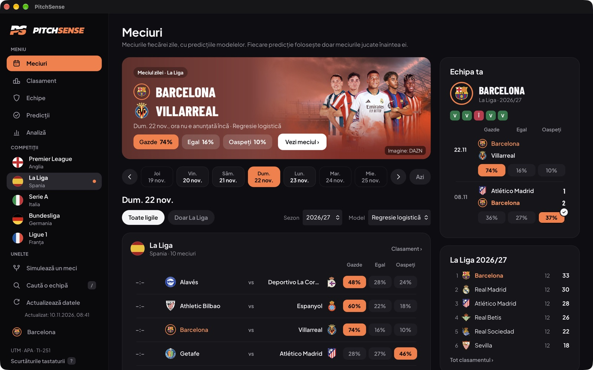
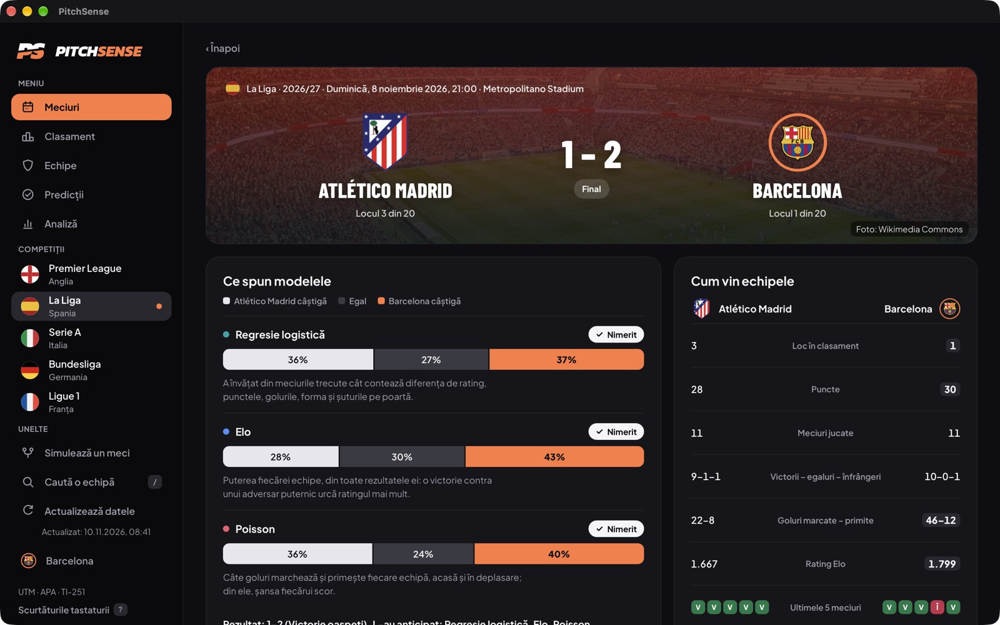
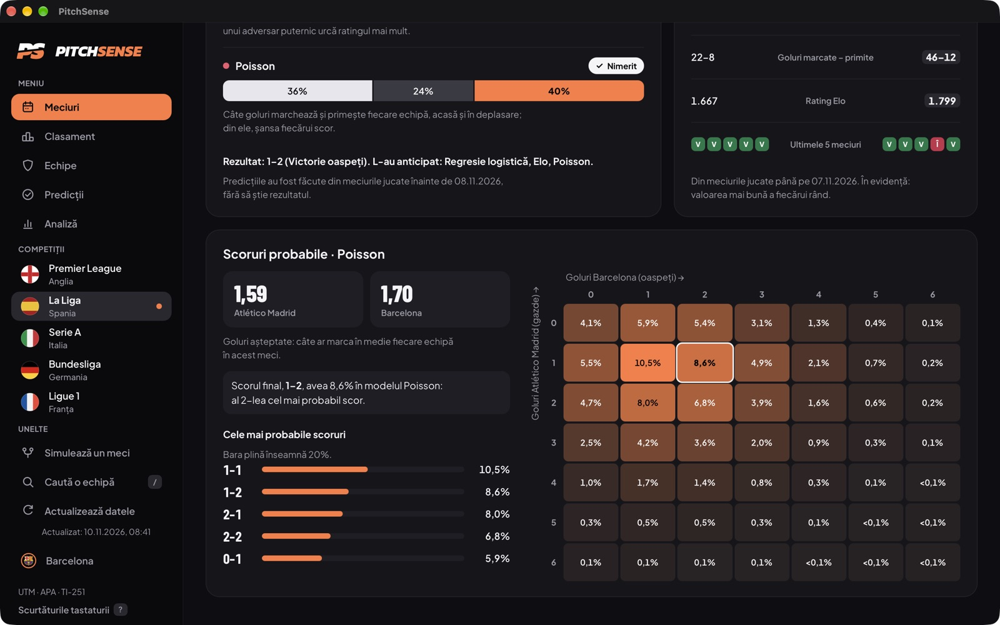
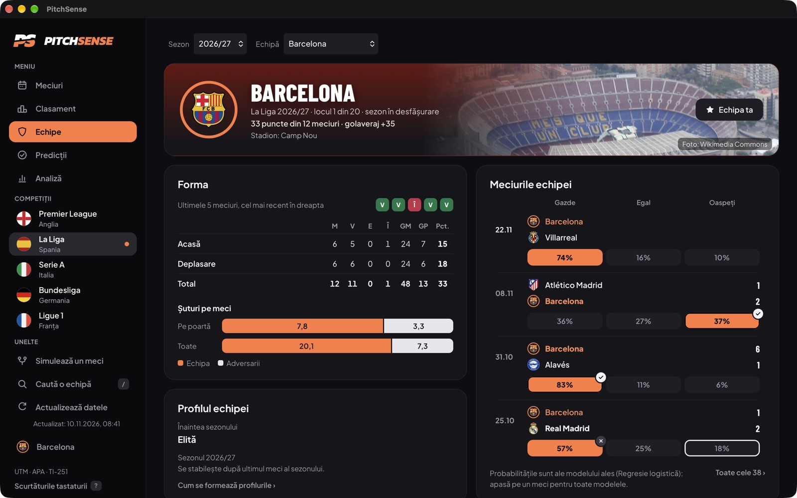
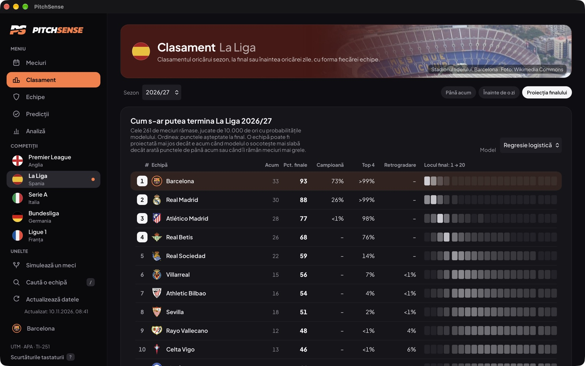
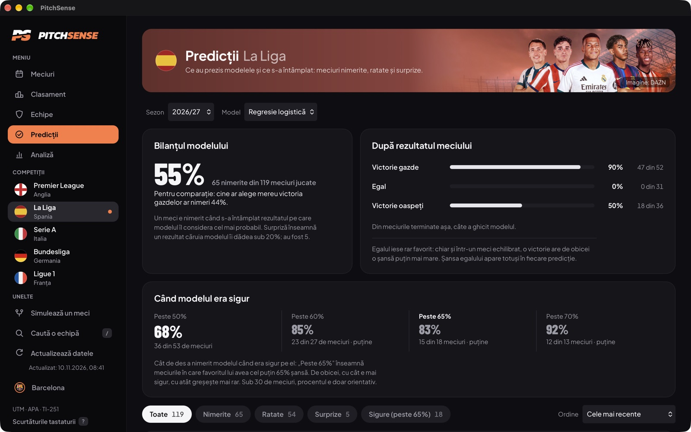
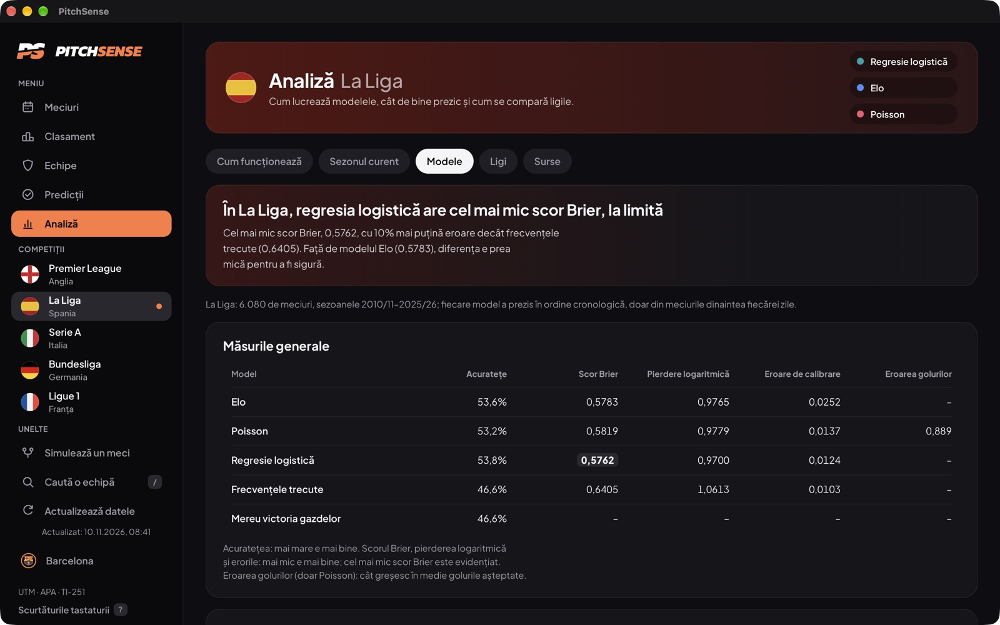

<p align="center">
  <picture>
    <source media="(prefers-color-scheme: dark)" srcset="docs/images/logo-dark.png">
    
  </picture>
</p>

<p align="center">
  <b>Analiza și predicția rezultatelor meciurilor de fotbal, cu patru algoritmi scriși de la zero</b>
</p>

<p align="center">
  <a href="https://github.com/kirillthehighest/Pitch-Sense/releases/latest"></a>
  
  
  
</p>



PitchSense este o aplicație desktop pentru macOS și Windows. Învață din **36.197 de meciuri** jucate în cinci campionate europene, între 2006 și 2026, și estimează rezultatul meciurilor care urmează. Toate predicțiile vin de la algoritmi implementați de noi după formulele lor matematice, fără biblioteci de învățare automată. Fiecare algoritm a fost verificat în ordinea timpului, exact cum ar fi lucrat în realitate.

Proiect de an la disciplina *Analiza și Proiectarea Algoritmilor*, Universitatea Tehnică a Moldovei.

## Ce face aplicația

- arată meciurile fiecărei zile din **Premier League, La Liga, Serie A, Bundesliga și Ligue 1**, cu șansele fiecărui rezultat și cât au nimerit modelele în sezonul curent;
- deschide pagina unui meci: pe ce rezultat mizează fiecare model și de ce, scorurile cele mai probabile și cum vin echipele;
- găsește orice echipă și simulează orice meci dintre două echipe ale aceluiași sezon, la o dată aleasă, dintr-un singur câmp de căutare;
- arată clasamente, inclusiv „înainte de o zi”, și **proiecția finalului de sezon**: meciurile rămase jucate de 10.000 de ori din predicțiile modelelor;
- arată pagina fiecărei echipe, cu ratingul Elo și tipul ei de joc;
- verifică un sezon întreg, săptămână cu săptămână: ce predicții s-au adeverit, care au fost surprizele și cât de des are dreptate un model când e sigur;
- se folosește și de la tastatură (tasta `?` arată scurtăturile), își actualizează singură sezonul în desfășurare și merge și fără internet.

## Cei patru algoritmi

| Algoritm | Întrebarea la care răspunde | Cod | Cum funcționează |
|---|---|---|---|
| **Ratingul Elo** | Cât de puternică este fiecare echipă? | [`elo.py`](app/algorithms/elo.py) | [elo.md](docs/algorithms/elo.md) |
| **Modelul Poisson** | Câte goluri va marca fiecare echipă și ce scor e cel mai probabil? | [`poisson.py`](app/algorithms/poisson.py) | [poisson.md](docs/algorithms/poisson.md) |
| **Regresia logistică** | Ce spun toți indicatorii împreună despre victorie, egal sau înfrângere? | [`logistic_regression.py`](app/algorithms/logistic_regression.py) | [logistic_regression.md](docs/algorithms/logistic_regression.md) |
| **K-Means** | Ce tipuri de echipe există într-o ligă? | [`kmeans.py`](app/algorithms/kmeans.py) | [kmeans.md](docs/algorithms/kmeans.md) |

Algoritmii folosesc doar Python și NumPy. Un test automat verifică faptul că niciunul nu importă scikit-learn, SciPy sau statsmodels.

Regula de bază a proiectului: **o predicție folosește doar meciurile jucate înaintea zilei ei.** Testele schimbă rezultatul unui meci și verifică faptul că nicio predicție pentru acel meci sau pentru meciurile dinaintea lui nu se modifică.

## Cât de bine prezice

Modelele au fost testate cronologic pe **28.893 de meciuri** (sezoanele 2010/11–2025/26, toate cele cinci ligi). Pentru fiecare zi cu meciuri, modelul vede doar ce s-a jucat înainte, își dă predicțiile și abia apoi află rezultatele.

| Model | Rezultate ghicite | Scor Brier (mai mic = mai bine) |
|---|:---:|:---:|
| **Regresia logistică** | **52,4%** | **0,5884** |
| Ratingul Elo | 52,2% | 0,5921 |
| Modelul Poisson | 51,8% | 0,5949 |
| *Referință: frecvențele sezonului trecut* | 44,6% | 0,6468 |
| *Reper: casele de pariuri* | 53,6% | 0,5768 |

Când regresia logistică dă peste 65% unui rezultat, are dreptate în **76,0%** din cazuri, iar asta se întâmplă la 14% din meciuri. Casele de pariuri rămân înainte. Cotele lor sunt folosite doar ca reper și nu intră în niciun model. Toate analizele sunt în [docs/leagues.md](docs/leagues.md) și [docs/comparison.md](docs/comparison.md).

## Capturi din aplicație

<table>
  <tr>
    <td width="50%"><br><sub><b>Pagina unui meci:</b> ce spune fiecare model și cine a nimerit</sub></td>
    <td width="50%"><br><sub><b>Scorurile probabile</b> ale modelului Poisson, cu scorul final încercuit</sub></td>
  </tr>
  <tr>
    <td><br><sub><b>Pagina unei echipe:</b> sezonul în cifre, forma și meciurile</sub></td>
    <td><br><sub><b>Proiecția finalului de sezon:</b> meciurile rămase jucate de 10.000 de ori</sub></td>
  </tr>
  <tr>
    <td><br><sub><b>Predicții:</b> ce a nimerit un model și cât de des are dreptate când e sigur</sub></td>
    <td><br><sub><b>Analiză:</b> care model prezice cel mai bine, apoi cum funcționează fiecare</sub></td>
  </tr>
</table>

## Instalare

Descărcați ultima versiune de pe pagina [**Releases**](https://github.com/kirillthehighest/Pitch-Sense/releases/latest). Pachetele conțin deja datele și nu cer Python.

| Sistem | Fișier | Cerințe |
|---|---|---|
| macOS | `PitchSense-<versiune>-macOS-arm64.dmg` | Mac cu Apple Silicon, macOS 14 sau mai nou |
| Windows | `PitchSense-<versiune>-Windows-amd64-setup.exe` | Windows 10 sau 11, pe 64 de biți |

Pachetele nu sunt semnate cu un certificat de dezvoltator, așa că sistemul cere o confirmare la prima deschidere:

- **macOS:** trageți PitchSense în *Applications*, deschideți-o, apoi în *System Settings → Privacy & Security* alegeți *Open Anyway*;
- **Windows:** la mesajul „Windows protected your PC” alegeți *More info*, apoi *Run anyway*.

## Rulare din codul sursă

Aveți nevoie de **Python 3.14**, **Node 26** și **Rust** (pentru fereastra Tauri).

```bash
git clone https://github.com/kirillthehighest/Pitch-Sense.git
cd Pitch-Sense
python3 -m venv .venv
source .venv/bin/activate            # pe Windows: .venv\Scripts\activate.bat
python -m pip install -e ".[dev]"
python -m app.data.build_database    # baza de date, din fișierele CSV din data/raw
python -m app.evaluation.backtesting # evaluarea cronologică a modelelor
cd web
npm ci
npm run tauri dev                    # deschide aplicația
```

Testele, cu mediul virtual activat:

```bash
python -m pytest                     # testele Python, pe date sintetice
cd web && npm test                   # testele interfeței
```

## Structura proiectului

```text
app/
  algorithms/   Elo, Poisson, regresia logistică, K-Means (Python și NumPy)
  data/         citirea și verificarea datelor, baza de date SQLite, sezonul în desfășurare
  statistics/   statisticile echipelor la o anumită dată
  prediction/   motorul de predicție și setările fiecărei ligi
  evaluation/   evaluarea cronologică, măsurile și comparațiile
  services/     rezultatele gata de afișat
  api/          serverul local (FastAPI)
web/            interfața (React, TypeScript, Recharts) în fereastra Tauri
tests/          testele automate
data/raw/       datele istorice, câte un fișier CSV pe sezon și ligă
docs/           documentația algoritmilor și a evaluării
```

## Documentație

- [Arhitectura aplicației](docs/architecture.md)
- [Evaluarea modelelor](docs/evaluation.md), [compararea algoritmilor](docs/comparison.md) și [comparația celor cinci ligi](docs/leagues.md)
- Algoritmii: [Elo](docs/algorithms/elo.md), [Poisson](docs/algorithms/poisson.md), [regresia logistică](docs/algorithms/logistic_regression.md), [K-Means](docs/algorithms/kmeans.md)

## Tehnologii

Python 3.14 · NumPy · pandas · SQLite · FastAPI · React 19 · TypeScript · Recharts · Tauri 2 · pytest · Vitest

## Date și imagini

Rezultatele și cotele vin de la [Football-Data.co.uk](https://www.football-data.co.uk). Calendarul sezonului în desfășurare vine de la [openfootball/football.json](https://github.com/openfootball/football.json) (CC0). Stemele cluburilor, fotografiile stadioanelor și imaginile ligilor aparțin deținătorilor lor. Sunt folosite doar ca echipele și ligile să fie ușor de recunoscut, într-un proiect universitar.

## Echipa

**Goroșevschi Chiril**, **Cuzmici Nicolae**, **Păstru Alina**: grupa TI-251, Facultatea Calculatoare, Informatică și Microelectronică, Universitatea Tehnică a Moldovei.

Coordonator: Muntean Mihai, asist. univ.
